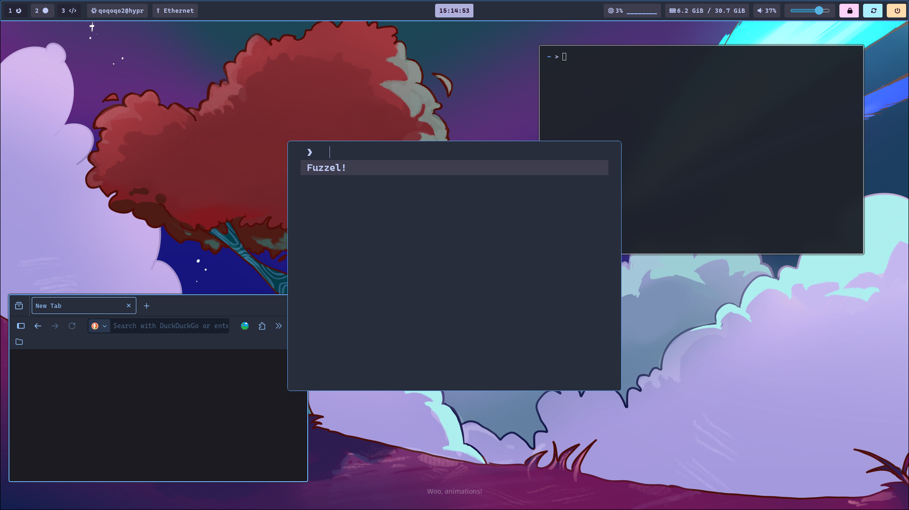
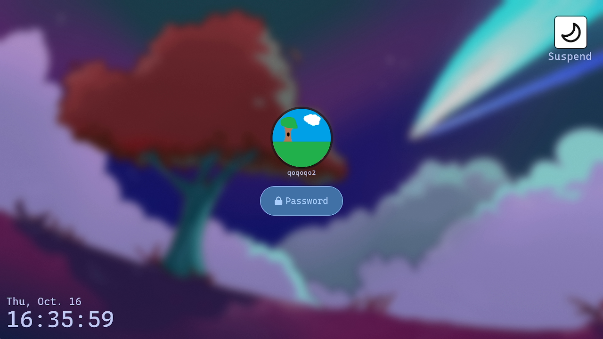

# Dotfiles

hyprland config idk

## Stuff

- **Window Manager:** Hyprland  
- **Terminal Emulator:** Alacritty
- **Editor**: Neovim w/ Lazyvim
- **Shell:** Zsh w/ ohmyzsh & tmux
- **Launcher:** Rofi
- **Browser**: Zen

## Screenshots

*kinda outdated tho*

